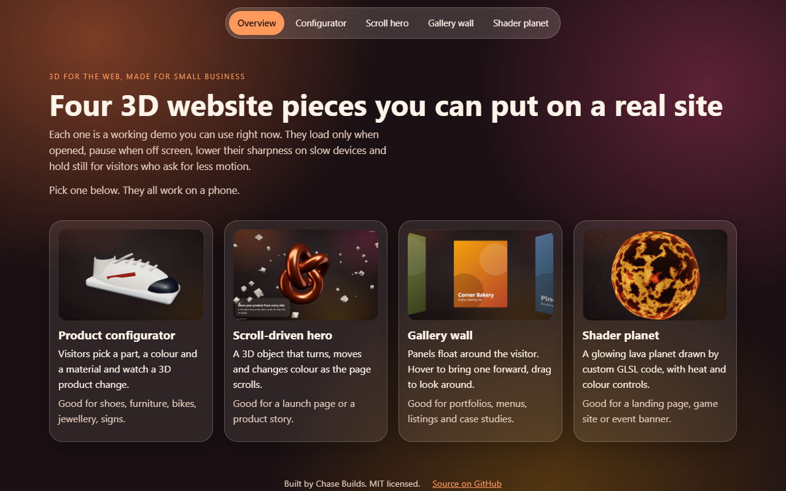

# r3f-showcase

[](https://github.com/chasebuilds/r3f-showcase/actions/workflows/ci.yml)
[](LICENSE)

Four interactive 3D pieces you can put on a small business website, each one a ready-to-use component: a product configurator, a scroll-driven landing hero, a floating gallery wall and a glowing lava planet. They run in the browser with no plugin, and they are tuned to stay fast on phones.

**Live demo:** https://chasebuilds.github.io/r3f-showcase/



## What a client gets

| Piece | What the visitor sees | Where it fits |
| --- | --- | --- |
| Product configurator | A 3D shoe. They pick a part, a colour and a material and the price updates. | Shoes, furniture, bikes, signs, jewellery |
| Scroll-driven hero | A 3D object that turns, moves and changes colour as they scroll. | Launch pages, product stories |
| Gallery wall | Panels floating in a ring around them. Hover to bring one forward, drag to look around. | Portfolios, menus, listings, case studies |
| Shader planet | A glowing lava planet with heat, speed and colour controls. | Landing pages, game sites, event banners |

All four work on a phone. If a visitor's device cannot show 3D, they see a plain text message instead of a broken page.

## Speed and comfort

Each scene goes through one shared wrapper (`src/lib/SceneCanvas.tsx`) that applies the same rules:

- **Loads only when opened.** Every scene is its own lazy-loaded route. The overview page has no 3D code at all.
- **Adapts to the device.** Sharpness (pixel ratio) moves between 0.75 and 2 based on measured frame rate.
- **Stops when you cannot see it.** The scene stops drawing when it is scrolled out of view or the tab is in the background.
- **Draws only when needed** for scenes with nothing animating (frame loop on demand).
- **Reduced motion.** If the visitor has "reduce motion" turned on, nothing drifts or spins by itself. The scenes still react to clicks, drags and scrolling.
- **Small models.** There are no model files. The shoe is built from basic shapes in code and the gallery images are drawn in code, so a scene costs no extra downloads.

A small badge in the corner of each scene shows its current mode (live, draws on change, paused) and pixel ratio, so you can see these rules working.

## Measured

Lighthouse performance score (mobile settings, Lighthouse 13, run against the live GitHub Pages site on 2026-11-22):

LIGHTHOUSE_TABLE

- Production JavaScript: LISTED_BUNDLE.
- 28 automated tests (logic, controls, routing, fallback).
- Scores depend on the machine and network. The scene pages were measured with a software renderer because the test machine had no GPU in the browser used by Lighthouse, so a real phone with a GPU should draw those scenes more easily. Treat the numbers as a guide, not a promise.

## Run it

```bash
npm ci
npm run dev        # local dev server
npm test           # Vitest
npm run lint       # ESLint
npm run typecheck  # tsc --noEmit
npm run build      # type-check and production build
```

## Use a scene in your own React project

Each scene is a component with typed props. Copy `src/lib/` and the scene folder you want.

```tsx
<LavaPlanet heat={0.7} speed={1} palette="magma" />

<GalleryWall items={myItems} activeIndex={active} onActiveChange={setActive} />

<ScrollHero steps={[{ title: 'Meet the product', body: 'One idea per screen.' }]} />

<ProductConfigurator onChange={(config) => addToCart(config)} />
```

## Project layout

| Path | Purpose |
| --- | --- |
| `src/lib/SceneCanvas.tsx` | Shared canvas wrapper with the performance rules |
| `src/lib/perf.ts` | Frame loop choice, pixel ratio mapping, reduced motion and visibility hooks |
| `src/scenes/ProductConfigurator.tsx` | Configurator (model in `configurator/`: shape, controls, price) |
| `src/scenes/ScrollHero.tsx` | Scroll-driven hero |
| `src/scenes/GalleryWall.tsx` | Gallery wall (ring layout and panel drawing in `gallery/`) |
| `src/scenes/LavaPlanet.tsx` | Planet; the GLSL is in `planet/shader.ts` |
| `src/pages/` | One lazy-loaded page per scene |
| `.github/workflows/` | CI (lint, type-check, tests, build) and Pages deploy |

Built with React 19, TypeScript (strict), Vite, three.js, `@react-three/fiber` and `@react-three/drei`. The shoe, the panel images, the planet shader (its own noise and crack code) and all layout maths are original to this repo. There are no downloaded models, textures or fonts.

## Limitations

- The shoe is a simple stylised model made from shapes. A real client product would use a modelled file (glTF), which this code can load with `useGLTF` but does not include.
- The configurator price is a made-up sample, not connected to a shop or cart.
- The tests cover logic, controls, routing and the no-3D fallback. The 3D drawing itself is checked by eye, not by automated image tests.
- Pointer hover on the gallery is for mouse users. On touch screens a tap or the Previous and Next buttons turn the ring.
- The scroll hero reads scroll position directly, so it assumes the page scrolls normally in the browser window.

## License

MIT, see [LICENSE](LICENSE).
